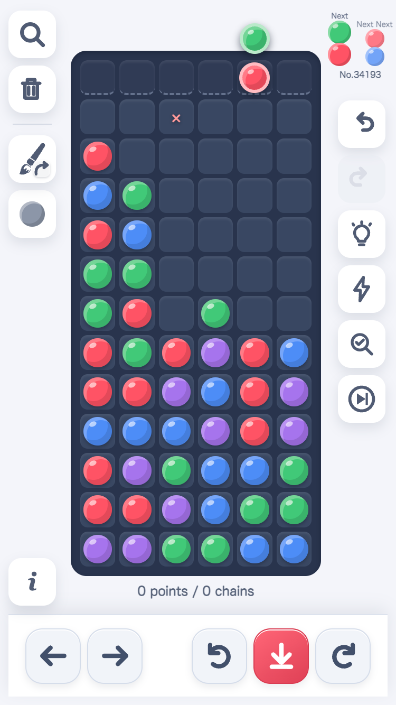
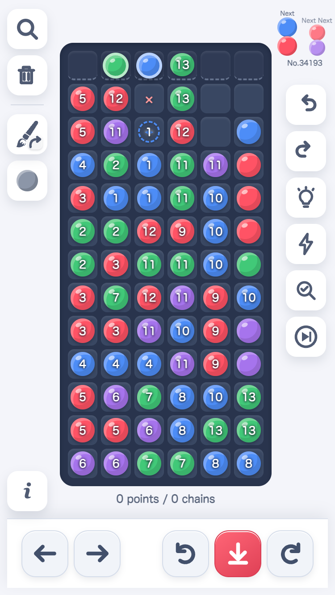
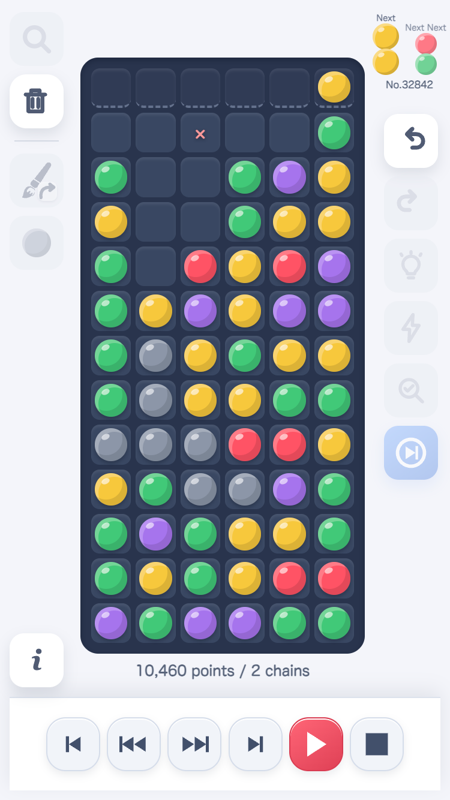
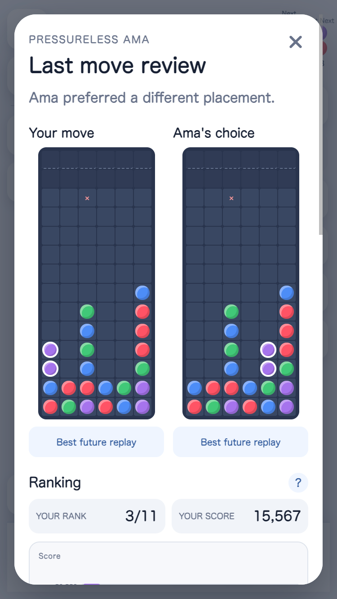
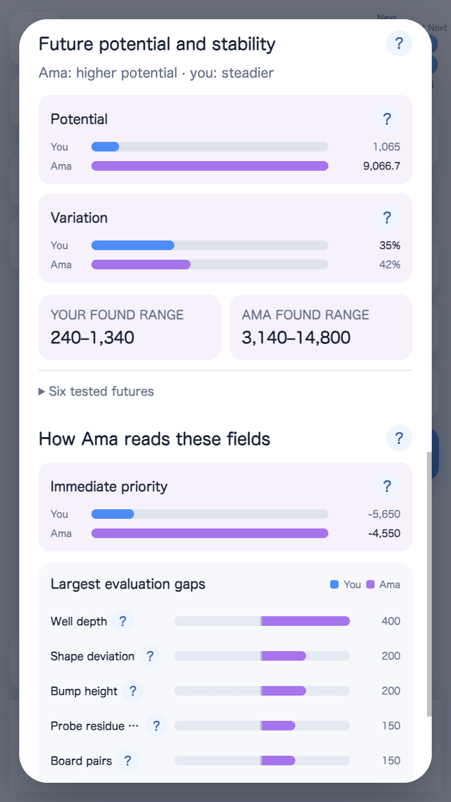
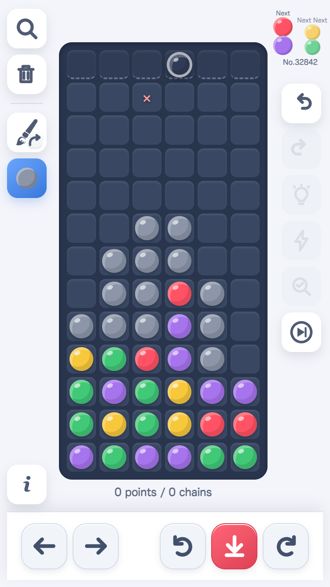
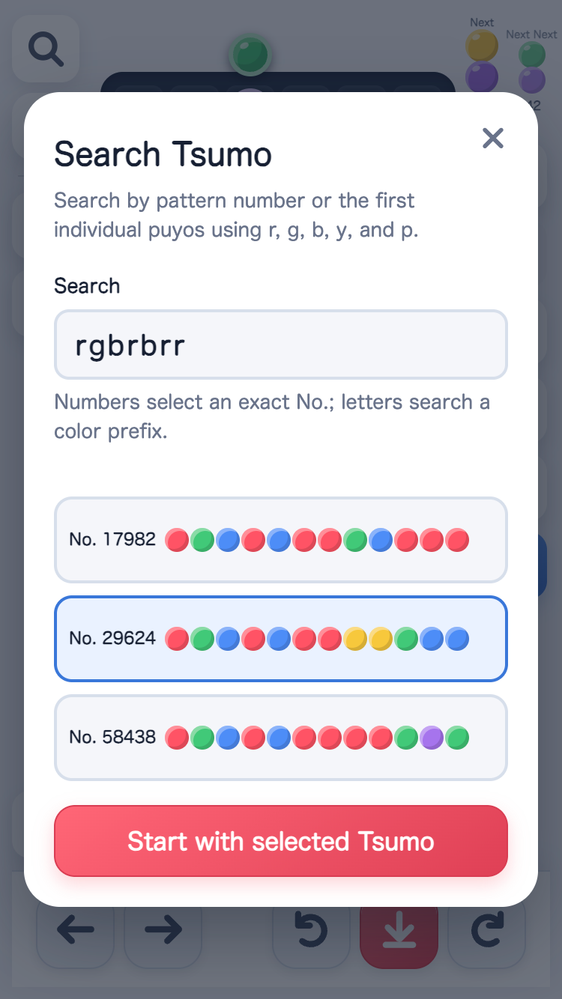
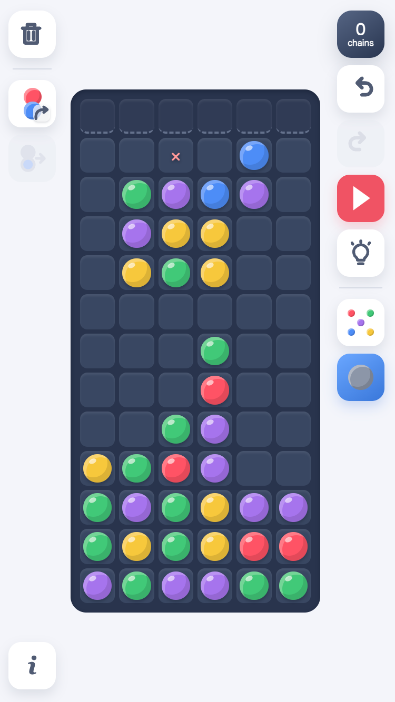
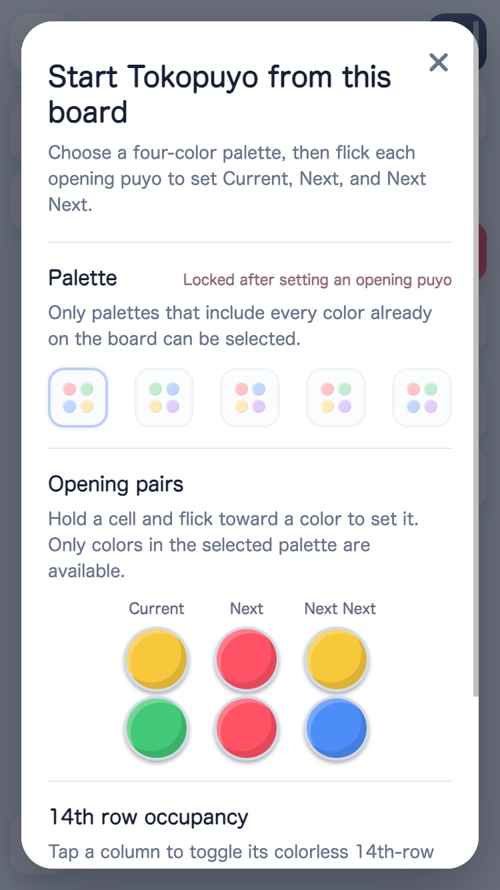

# Puyo Chain Simulator

> Powered by [Ama](https://github.com/citrus610/ama)

> Draw a board, test the chain, and build longer chains with Ama.

A touch-friendly, dependency-free Puyo Puyo board lab for experimenting with chain ideas on a phone or desktop. The app opens in Tokopuyo mode for step-driven practice; Drawing mode is the board-building submode for freely placing puyos, simulating chains, and exploring ideas before returning to the retained Tokopuyo session.

<p align="center">
  <a href="https://yushiomote.github.io/puyo-draw/">Try Puyo Chain Simulator</a>
</p>

<p align="center">
  
</p>

<p align="center"><sub>Tokopuyo mode is the main experience: play a pattern with Current, Next, and Next Next always in view.</sub></p>

## Explore the features

<table>
  <thead>
    <tr>
      <th align="left">What you can do</th>
      <th align="center">See it in action</th>
    </tr>
  </thead>
  <tbody>
    <tr>
      <td>
        <strong>Get long-chain construction suggestions</strong><br />
        Ask Ama to search the current field for promising placements. Numbered candidates make the potential of each route easy to compare at a glance.
      </td>
      <td align="center">
        
      </td>
    </tr>
    <tr>
      <td>
        <strong>Inspect chains step by step</strong><br />
        Turn on chain step mode to pause the result and move through each round with first, previous, next, last, play, and stop controls.
      </td>
      <td align="center">
        
      </td>
    </tr>
    <tr>
      <td>
        <strong>Review your last move with Ama</strong><br />
        Compare your placement with Ama's preferred choice, then inspect the ranking and score to understand why another route was stronger. Learn more from the <a href="https://github.com/citrus610/ama">official Ama AI project</a>.
      </td>
      <td align="center">
        
        <br />
        
      </td>
    </tr>
    <tr>
      <td>
        <strong>Drop garbage puyos</strong><br />
        Enable Tokopuyo garbage mode to replace the active pair with a movable garbage puyo. Use it to practice handling pressure and see how garbage interacts with clearing groups.
      </td>
      <td align="center">
        
      </td>
    </tr>
    <tr>
      <td>
        <strong>Search and start a specific Tsumo</strong><br />
        Find a pattern by its number or by entering the first puyo colors, compare matching sequences, and start Tokopuyo with the selected Tsumo.
      </td>
      <td align="center">
        
      </td>
    </tr>
    <tr>
      <td>
        <strong>Build and test a board in Drawing mode</strong><br />
        Move from Tokopuyo into the Drawing submode to place colored or garbage puyos, erase cells, and simulate the settled field. When the board is ready, choose the opening pairs and start Tokopuyo directly from your drawing.
      </td>
      <td align="center">
        
        <br />
        
      </td>
    </tr>
  </tbody>
</table>

Ama's output is a bounded search and heuristic signal for exploring ideas—not a guarantee of the globally optimal move.

## Ama attribution

The Tokopuyo suggestions and last-move review use the [Ama](https://github.com/citrus610/ama) AI project by citrus610. Ama is distributed under the MIT License (Copyright (c) 2023 citrus610); the pinned upstream source used by this project is included in [`third_party/ama`](third_party/ama), with its license text in [`third_party/ama/LICENSE`](third_party/ama/LICENSE).

## A quick tour

1. Open the [live demo](https://yushiomote.github.io/puyo-draw/). It starts in Tokopuyo mode with a random pattern.
2. Practice with Current, Next, and Next Next using the move, rotate, and drop controls.
3. Switch to Drawing mode, hold a cell, and flick toward a color to sketch a board.
4. Tap Suggestion to see possible extensions, then Simulate to watch the chain resolve.
5. Start Tokopuyo from This Board to practice the designed field, or switch back to return to the retained Tokopuyo session. Then try long-chain Suggestion, emergency-attack Suggestion, Review Last Move, and chain step mode.

## Local Development

Start the included cache-disabled development server:

```sh
npm run dev
```

Open <http://localhost:4173> on the Mac. The server listens on all network interfaces, so an iPhone on the same Wi-Fi can use the Mac's local IP address, such as `http://192.168.1.23:4173`. On macOS, find the Wi-Fi address with `ipconfig getifaddr en0`.

If the iPhone cannot connect, allow incoming connections for the terminal or Node.js in macOS Firewall settings, and make sure both devices are on the same network. The server is intended for local development and is not an internet-facing server.

The development server sends `Cache-Control: no-store`, so JavaScript module changes take effect on the same port without a hard refresh. A different port can be passed after `--`, for example `npm run dev -- 4180`.

Run the logic tests with:

```sh
npm test
```

## GitHub Pages

Pushing to the `main` branch triggers `.github/workflows/deploy.yml`. The workflow adds the deployment commit SHA to every local JavaScript and CSS URL before upload, preventing modules from different releases from being mixed by browser caches. In the repository settings, set Pages → Build and deployment → Source to **GitHub Actions**.

### Search appearance

The static HTML supplies the title, feature-focused description, canonical Pages
URL, and matching Open Graph and Twitter metadata before JavaScript runs. The
copy describes Drawing-mode board building and chain simulation, Ama AI move
suggestions in Tokopuyo, and Preview-mode replay and URL sharing. These features
run in the browser without a paid service or installation. Suggestions are
heuristic guidance, not a guarantee of the best move.

Keep the search and social descriptions aligned. The static document uses
`lang="en"` to match its initial text. The existing localization code still sets
the document language and browser title to the selected English or Japanese
locale. Search and social descriptions stay in English; changing the locale does
not rewrite them. The help overlay uses `data-nosnippet` to exclude manual
instructions from Google's snippets without changing visible text or controls.

GitHub Pages serves static files. It cannot produce a different social preview
for each `#r=` replay, since URL fragments are not sent to the server. The
canonical and Open Graph URLs therefore identify the app's base URL. No server
rendering or crawler-specific rendering is needed for this metadata.

Open Graph and Twitter use the existing `docs/media/ama-chain-suggestions.png`
screenshot at its absolute Pages URL. The image is 750 by 1334 pixels and about
514 KiB. The Twitter card requests `summary_large_image`; platforms may crop the
portrait screenshot. The original asset is retained without resizing, and both
image tags include descriptive alternative text. Check the actual preview after
deployment because the platform controls rendering and may cache old metadata.
JSON-LD is omitted: the app has no visible ratings or reviews, and extra
structured data is not needed for this change.
Explicit `index,follow` robots metadata is unnecessary. A robots.txt inside
`/puyo-draw/` would not control crawling; that file must be at the host root.
A sitemap is omitted because the app has one public entry page and replay
fragments do not represent separate crawlable pages. No alternate-language URLs
exist, so no `hreflang` links are added.

Google chooses the final snippet for each query. It may use the description or
other eligible page content, and may truncate the result to fit the device.
After deployment, request indexing of the canonical URL in Google Search Console
if available. Changes require Google to crawl the page again; neither this copy
nor `data-nosnippet` guarantees that Google will show the meta description.
See [Google's snippet guidance](https://developers.google.com/search/docs/appearance/snippet).

### Site icons

The page uses `favicon.svg` for scalable browser icons, `favicon.ico` for
compatibility, and the 180 by 180 pixel `apple-touch-icon.png` for iOS Home screen
shortcuts. Keep these URLs stable. The files are copied into the Pages artifact
by the existing deployment workflow; no extra build step is needed.

`site.webmanifest` supplies the app name, scoped launch URL, and SVG/PNG icons for
browsers that use a manifest for Home screen shortcuts. Paths are relative so
they resolve under `/puyo-draw/` on Pages and at the root during local testing.
The launch URL opens the base app. `display: browser` preserves browser behavior;
this change does not add offline support or guarantee installability. The icons
use `purpose: any`; the supplied artwork is not declared as maskable.

Google Search supports one favicon per hostname, not one per project path.
For this Pages deployment, configure the same ICO or PNG favicon link on
`https://yushiomote.github.io/` in the repository that owns that home page.
Changes here configure tabs and shortcuts but cannot independently select a
Google Search favicon for `/puyo-draw/`. Google must be able to crawl both the
host home page and the icon, and display is not guaranteed after recrawling.
See [Google's favicon guidance](https://developers.google.com/search/docs/appearance/favicon-in-search).

### Optional traffic analytics

The site includes an opt-in Cloudflare Web Analytics integration for basic page views and performance metrics. To enable it:

1. In Cloudflare Web Analytics, add the deployed hostname and copy the JavaScript site token.
2. Set the `content` value of `meta[name="cloudflare-web-analytics-token"]` in `index.html` to that token.
3. Deploy the site and wait a few minutes for data to appear in the Cloudflare dashboard.

Leave the value empty to keep analytics disabled. See the [Cloudflare setup guide](https://developers.cloudflare.com/web-analytics/get-started/) for the dashboard steps.

## Documentation

- [Product concept](docs/CONCEPT.md)
- [Product specification](docs/SPECIFICATION.md)
- [Tokopuyo specification](docs/TOCOPUYO_TSUMO_SPECIFICATION.md)
- [Tokopuyo implementation plan](docs/TOCOPUYO_IMPLEMENTATION_PLAN.md)
- [Contribution guidelines](AGENTS.md)
